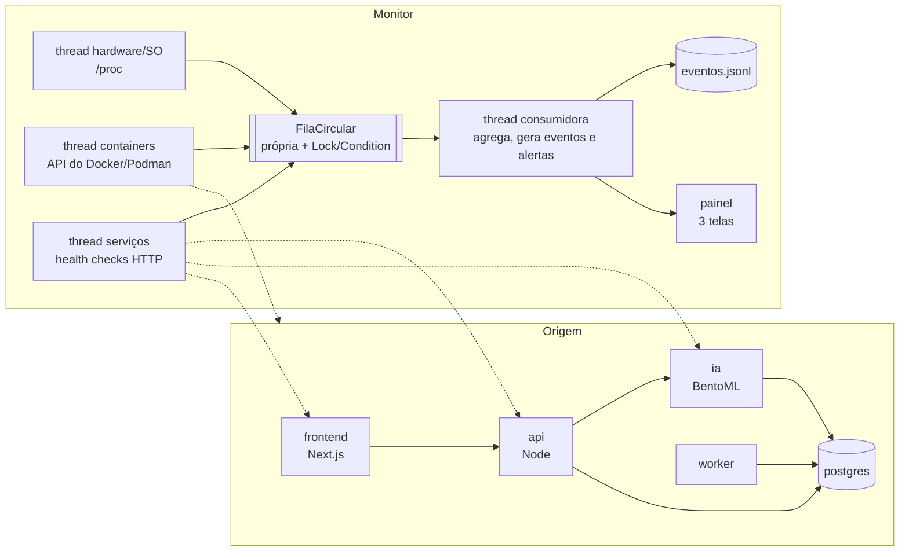

# Plano do PI 3 — AED e Infraestrutura de Software no Origem

> Plano para aplicar ao Origem os requisitos do Projeto Integrador de **Algoritmos e Estrutura de Dados** e de
> **Infraestrutura de Software**, as duas com o professor David Carlos Pereira da Cunha, em 2026.2.
> Fontes: o site do PI, `dcpc-cesar-school.github.io/projeto-integrador3-26.2`, e a planilha "Projeto Integrador AED SO".

**Data:** 24/11/2026 · **Versão:** 1.0 · **Branch:** `feat/pi3-aed-infra-plano`
**Prazos:** pré-entrega **26/11**, com o painel integrado ao coletor · entrega final **03/12 (AV2)**, com documentação e demonstração ao vivo
**Concorre com:** IA Projeto Final em 27/11, já pronto e faltando só o envio, e a entrega de Web em 02/12, que ainda depende do deploy.

---

## Andamento

| Etapa | Situação | Commit |
|---|---|---|
| P0 | ✅ plano | `426e482` |
| P1 | ✅ Dockerfiles da API e do worker, da IA e do front; `compose.yaml` na raiz com `mem_limit` e healthchecks | `23f17ed` |
| P2 | ✅ `estruturas/`: Vetor fixo, lista, pilha, fila, fila circular thread-safe, tabela hash e árvore binária de busca, com 32 testes | este |

**Validação da P1, em 24/11:** build das 3 imagens; `docker compose up -d` com os 5 serviços no ar, os 4 healthchecks
`healthy` e nenhum reinício; site em `localhost:3000`; catálogo, login e recomendações com fonte "ia" pelo rewrite
`/api` do front; pedido criado com status 201 e os 2 avisos consumidos pelo worker no container dele. Uso de memória
entre 5% e 23% do limite de cada serviço.

**Aprendizados para as próximas etapas:**
- No Podman sem root, o build precisa de `DOCKER_BUILDKIT=0`.
- Containers criados pela API do Podman herdam `oom_score_adj` 200 e o `exec` dos healthchecks falha. Com 300 funciona, e isso está no `compose.yaml`.
- `docker stats` pelo Podman corta o primeiro caractere do nome, "rigem-api-1". O coletor da P4 deve usar a API pelo socket, e não a saída do CLI.

**Validação da P2, em 24/11:** `uv run python -m unittest discover -s testes` com 32 testes aprovados em 3 rodadas seguidas,
incluindo 4 produtores e 3 consumidores trocando 20 mil itens por uma fila circular de 8 posições, sem perda nem
duplicação. O teste `test_sem_colecoes_prontas` lê o código das estruturas e falha se aparecer list, dict, set,
`sorted`, `.sort()` ou `collections`; a sabotagem dele confirma que acusa as 4 violações plantadas. Os testes acharam
um bug antes do commit: `in` na tabela hash lançava erro em vez de devolver False.

- O armazenamento por índice usa um array C de tamanho fixo via `ctypes`, e não a lista do Python.
- A GIL esconde a condição de corrida: removendo a trava da fila circular, 4 threads × 3000 itens não perderam nada em
  3 rodadas. O teste de threads prova que a fila funciona sob concorrência, mas não que pegaria a falta da trava. A
  demonstração da P7 precisa alargar a janela entre ler e gravar, por exemplo com `time.sleep(0)` no meio.

---

## 1. Ponto de partida

Em 24/11 o PI 3 está em **cerca de 7%**. Quase tudo o que já existe vem do próprio Origem, não de trabalho feito para este PI.

| Já existe no Origem | Como entra no PI 3 |
|---|---|
| Checkout ingênuo × seguro, com evidências, do FCCPD U1 | Race condition demonstrada e corrigida entre transações. Falta a versão com threads |
| API → fila no Postgres → worker | Produtor–consumidor entre processos, que serve de exemplo. O coletor vai ser o produtor–consumidor com threads |
| 149 testes da API e testes do módulo de IA | Base do pipeline de CI |
| `backend/docker-compose.yml`, só com o Postgres e com healthcheck | Ponto de partida do Compose completo |
| `/saude` na API e `/healthz` no BentoML | Health checks da tela de serviços |
| `docs/arquitetura.md` e o diagrama do FCCPD U2 | Base do diagrama, que ganha o monitor |

Falta todo o núcleo avaliado: as estruturas próprias, a ordenação e a busca, o coletor com threads, o painel com as 3 telas, os alertas de memória, o CI e os containers da aplicação.

---

## 2. Decisões de arquitetura

**Linguagem do PI 3: Python 3.13, gerenciado com `uv`.** É a linguagem do módulo de IA, então as estruturas de AED podem ser aplicadas no código real do Origem sem uma segunda implementação. Também é simples ler o `/proc`, criar threads e usar `threading.Lock` e `threading.Condition`. A GIL não atrapalha o coletor, que passa a maior parte do tempo esperando por E/S.

**Tudo em pastas novas.** Nada do que a Web avalia em 02/12 muda de comportamento. O código existente só é tocado nos pontos onde as estruturas são aplicadas, no `ia-recomendacao/`, e sempre com os testes da IA passando antes e depois.

```
estruturas/          # AED: pacote Python próprio, sem coleções prontas nas partes avaliadas
  estruturas/        #   lista.py, pilha.py, fila.py, fila_circular.py, hash.py, arvore_busca.py
                     #   ordenacao.py, busca.py, dominio.py
  testes/            #   unittest, da biblioteca padrão
  benchmark.py       #   tempos por algoritmo e volume, para a análise de complexidade
monitor/
  pratica1/monitor.sh
  coletor/           # threads coletoras → FilaCircular sincronizada → thread consumidora → eventos
  painel/            # FastAPI + HTML/JS: telas de hardware e SO, containers e serviços
  demos/             # race_condition.py e produtor_consumidor.py
  Dockerfile
compose.yaml         # na raiz: o Origem completo, o coletor e o painel
backend/Dockerfile   frontend/Dockerfile   ia-recomendacao/Dockerfile
.github/workflows/ci.yml
docs/pi3/            # arquitetura.md, mapa-de-tecnicas.md, complexidade.md
```

**Arquitetura de execução**, que é a do enunciado: App → monitorada por → Coletor → Eventos → Painel.



**Como o coletor enxerga a máquina e os containers:**
- Hardware e SO: lê o `/proc` do host montado como `/host/proc`, somente leitura. Usa `/proc/stat` para CPU por núcleo, `/proc/meminfo` para memória, `/proc/diskstats` e `statvfs` para disco e `/proc/[pid]/status` para processos e threads.
- Containers: usa a API do Docker pelo socket, que é configurável por `DOCKER_SOCK`. Lê status, CPU, memória com uso e limite, `RestartCount` e `State.OOMKilled`. Na máquina de desenvolvimento, Bazzite com Podman, o socket é `/run/user/1000/podman/podman.sock` e é compatível com a API do Docker. Isso foi conferido em 24/11: `docker stats` funciona e o sistema usa cgroup v2.
- Serviços: faz um GET periódico em `/saude` da API, em `/healthz` da IA e na página inicial do front, medindo o tempo de resposta e o tempo no ar.

**Memória e OOM:** todo serviço do `compose.yaml` ganha `mem_limit`. O coletor gera um alerta quando um container passa de 80% e de 95% do limite, e um evento quando aparece `OOMKilled` ou quando o `RestartCount` sobe. Para a demonstração ao vivo existe um serviço `estressor`, com limite de 64 MB, que aloca memória até ser morto pelo OOM Killer.

---

## 3. Etapas

Esforço estimado com apoio de IA no código. A coluna "Requisito" usa os nomes do enunciado.

| Etapa | O que entrega | Requisito | Esforço | Data-alvo |
|---|---|---|---:|---|
| **P0** | Este plano, a branch e o professor como colaborador | Partida | 1 h | 24/11 |
| **P1** | Dockerfiles da API, do worker, da IA e do front; `compose.yaml` na raiz com `mem_limit` e healthchecks | Etapa 4 · nível mínimo | 5 h | 25/11 |
| **P2** | `FilaCircular` própria e thread-safe, primeiro; depois lista, pilha, fila, hash e árvore binária de busca, com testes | Etapa 1 · nível mínimo | 7 h | 25–26/11 |
| **P3** | Coletor mínimo, com a thread de hardware e SO e o consumidor, e o painel com a tela 1 de hardware e SO, tudo no Compose | Etapa 5 · **pré-entrega 26/11** | 6 h | 26/11 |
| **P4** | Threads de containers e de serviços, eventos, alertas de memória, OOM e o serviço `estressor`; telas 2 e 3 | Etapa 5 · coletor concorrente | 14 h | 27–28/11 |
| **P5** | `.github/workflows/ci.yml`: build e testes da API com Postgres de serviço, da IA, de `estruturas/`, do monitor e do front, mais `docker compose build` | Etapa 4 · CI | 3,5 h | 29/11 |
| **P6** | Ordenação e busca, aplicação das estruturas no Origem, `benchmark.py`, análise de complexidade e mapa de técnicas | Etapas 1 e 3 | 11 h | 29–30/11 |
| **P7** | `pratica1/monitor.sh`; `demos/race_condition.py`, com o erro e a correção; `demos/produtor_consumidor.py` | Etapa 2 · Prática 1 | 5 h | 30/11–01/12 |
| **P8** | Diagrama final, README com a stack justificada, `docs/pi3/`, roteiro e ensaio da demonstração | Etapa 6 | 5 h | 02/12 |
| | **Total** | | **≈ 57,5 h** | |

**Para a pré-entrega de 26/11** valem P1, P2 com a fila circular e P3, que somam cerca de 18 h. É o nível **mínimo**: app em container, Compose com monitor e painel, tela de hardware e SO e fila circular própria. Na apresentação de 26/11 dá para mostrar que as telas 2 e 3 estão em andamento.

### Critérios de pronto por etapa

- **P1:** `docker compose up -d` na raiz sobe o Origem inteiro do zero, o front abre em `localhost:3000` e todos os healthchecks ficam `healthy`. O `backend/docker-compose.yml` continua funcionando para quem usa só o banco.
- **P2:** cada estrutura tem inserir, remover e consultar, com os casos de borda testados: vazia, cheia no caso da fila circular, elemento inexistente e duplicado. Nenhuma usa `list`, `dict`, `set` ou `collections` como armazenamento. O arranjo interno é um vetor de tamanho fixo criado por nós ou nós encadeados. A `FilaCircular` tem `colocar` bloqueante e `retirar` com timeout, protegidos por `Lock` e `Condition`.
- **P3:** a tela 1 mostra CPU por núcleo, memória, disco, número de processos e de threads, atualizando sozinha.
- **P4:** a tela 2 mostra cada container com status, CPU, memória com uso e limite, reinícios e OOMKilled. A tela 3 mostra health, tempo de resposta, tempo no ar e a linha do tempo de eventos. Ao rodar o `estressor`, aparece o alerta de memória e depois o evento de OOMKilled.
- **P5:** o pipeline roda em todo push e PR e fica verde na `main`.
- **P6:** o mapa de técnicas tem, para cada técnica, onde aplica, por quê e a complexidade. O `benchmark.py` mede os algoritmos em volumes de 1 mil, 10 mil e 100 mil itens, e a análise compara o medido com o esperado.
- **P7:** a demonstração da race condition mostra um resultado errado sem a trava e o resultado certo com ela, de forma reproduzível.
- **P8:** o roteiro da demonstração cobre o deploy pelo pipeline, a carga, os alertas e a visão de arquitetura, que são os itens que o enunciado pede para 03/12.

---

## 4. Onde as estruturas entram no Origem

Este é o rascunho do mapa de técnicas, que será completado na P6. A rubrica de AED pede estoque, pedidos e histórico; o Origem tem os três.

| Técnica | Onde aplica | Por quê | Complexidade |
|---|---|---|---|
| Fila circular | Buffer entre as threads do coletor | Tamanho fixo e memória constante: quando enche, descarta a amostra mais antiga em vez de crescer | O(1) para colocar e retirar |
| Hash | Índice de produtos por id no módulo de IA, que hoje usa `dict` no `recomendador.py` | Consulta do produto em tempo constante durante a pontuação | O(1) médio |
| Lista | Estoque do catálogo em `estruturas/dominio.py`, carregado do banco | Percorrer o catálogo inteiro para pontuar e filtrar | O(n) para percorrer |
| Fila | Pedidos aguardando processamento, espelhando a fila do worker | A ordem de chegada importa | O(1) |
| Pilha | Histórico de operações de estoque com "desfazer" | A última operação é a primeira a ser desfeita | O(1) |
| Inserção ordenada | Saída de estoque por prioridade | A lista fica sempre ordenada sem reordenar tudo | O(n) por inserção |
| Árvore binária de busca | Produtos por preço, para buscar por faixa de preço | Busca por intervalo sem varrer o catálogo | O(log n) médio, O(n) no pior caso |
| Merge sort | Ordenação das recomendações por score, no lugar do `sorted` e do `.sort()` do `recomendador.py` | Estável e sempre O(n log n) | O(n log n) |
| Quick sort | Ordenação dos eventos do painel | Rápido na média e sem memória extra | O(n log n) médio |
| Insertion e selection sort | Listas pequenas, como o top-N de cada recomendação, e base de comparação | Simples e eficientes para n pequeno | O(n²) |
| Busca binária | Busca de produto numa lista ordenada por id | Lista já ordenada | O(log n) |
| Busca sequencial | Filtro de catálogo sem ordem | Sem pré-requisito de ordem | O(n) |

A troca do `dict` e do `sorted` no `ia-recomendacao/` tem que manter as mesmas respostas: os testes da IA e o `casos.sh` passam antes e depois, como numa refatoração.

---

## 5. Divisão sugerida

A equipe ainda precisa confirmar a divisão. A sugestão segue as camadas do Origem.

| Quem | Etapas |
|---|---|
| Everton | P1 containers, P3 e P4 coletor, P5 CI |
| A definir | P2 e P6 estruturas, ordenação, busca e mapa de técnicas |
| A definir | Telas do painel em P3 e P4, junto com quem fizer o coletor |
| Todos | P7 demonstrações e P8 documentação e ensaio |

Cada integrante faz os commits da própria parte na própria conta.

---

## 6. Riscos

| Risco | Efeito | Como reduzir |
|---|---|---|
| Prazo: cerca de 57 h em 9 dias, junto com a IA e a Web | O nível "esperado" pode não fechar | Garantir o mínimo em 26/11; cortar os bônus primeiro e depois o benchmark entre algoritmos |
| Socket do Podman dentro do container, com SELinux | O coletor não consegue ler os containers | Usar `security_opt: label=disable` só no coletor e testar logo na P3. Plano B: o coletor roda fora do Compose e lê pelo `docker` CLI |
| Mudança na IA quebrar a entrega de Web | Regressão em 02/12 | Os testes da IA e o roteiro do navegador antes do merge; as mudanças entram em PR separado |
| Rubrica de SO da planilha ser de redes | Mais cerca de 7 h: topologia, requisitos de rede, latência, jitter e plano de migração | Perguntar ao professor antes de 26/11 |
| Professor sem acesso ao repositório | O que não estiver visível não é avaliado | A Thainá adiciona o professor como colaborador, que é a P0 |

---

## 7. Pendências

- [ ] A Thainá adicionar o professor David como colaborador do repositório.
- [ ] Confirmar com o professor qual rubrica de SO vale, a de redes da planilha ou a de containers e threads do site, e se a rubrica de AED cobre a Unidade 2.
- [ ] Confirmar a equipe do PI 3 e a divisão da seção 5.
- [ ] Informar no Classroom de AED o WhatsApp de uma pessoa da equipe e o link do repositório.
